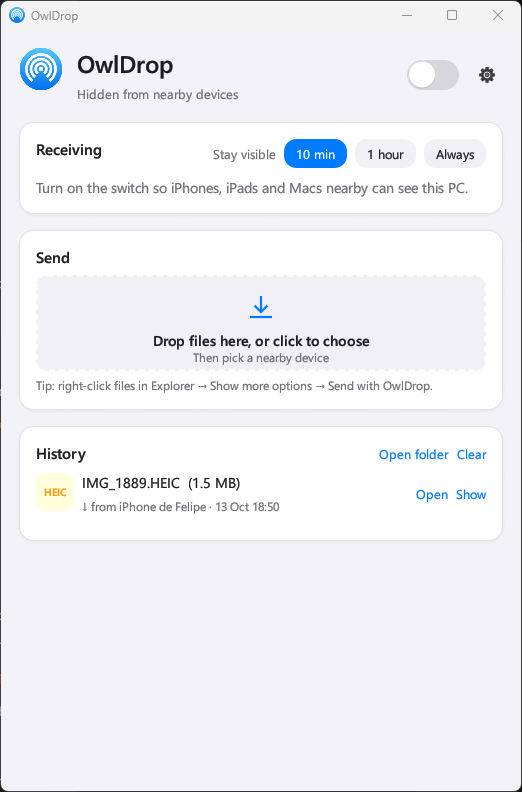
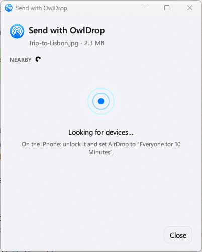

# OwlDrop

**AirDrop for Windows.** Send and receive files to and from iPhones, iPads and
Macs — using a cheap USB Atheros AR9271 Wi‑Fi dongle and WSL2. No app on the
Apple side; the PC shows up in the normal AirDrop share sheet and transfers work
both directions.

OwlDrop is a Windows front‑end and WSL integration layer built on top of existing
open‑source AirDrop research — see **[Credits](#credits)**. The name nods to
[OWL](https://github.com/seemoo-lab/owl), the open AWDL implementation it relies
on. It is **not** affiliated with or endorsed by Apple Inc.

<table>
  <tr>
    <td align="center"><b>Main window</b></td>
    <td align="center"><b>Send picker</b></td>
  </tr>
  <tr>
    <td></td>
    <td></td>
  </tr>
</table>

```
Windows                                    WSL2 Ubuntu
───────                                    ───────────
app/  owldrop.exe (Rust, egui)  ──JSON──►  wsl/airdrop-bridge  (approval, inbox, scans, sends)
      owldrop-ble.exe ◄── interop ───────  wsl/ble-airdrop-adv.py (BLE wake → Windows Bluetooth)
usbipd ── AR9271 ──────────────────────►   ath9k_htc (built by wsl/build-ath9k.sh)
                                           OWL → awdl0 → omdrop receiver / send-to-peer
```

A native Rust/egui app handles the UI, approvals and history; the actual AWDL +
AirDrop protocol runs in WSL2 through [OWL](https://github.com/seemoo-lab/owl)
and [omdrop](https://github.com/t4t5/omdrop-owl). The USB dongle is passed into
WSL with [usbipd‑win](https://github.com/dorssel/usbipd-win).

## Features

- **Receive** files from Apple devices, with an on‑screen approval prompt and a
  transfer history.
- **Send** files to Apple devices — drop them on the window, or right‑click in
  Explorer → **Send with OwlDrop** and pick a device.
- A Start‑Menu entry; the app self‑installs the WSL side and attaches the dongle
  on launch.
- Bluetooth "wake" advertising (via the host's own Bluetooth radio) so nearby
  devices surface the PC.

## Requirements

- Windows 10/11 with WSL2 (Ubuntu).
- A **USB Atheros AR9271** Wi‑Fi dongle (`0cf3:9271`, `ath9k_htc`). It is
  **2.4 GHz only** — see [Limitations](#limitations).
- [usbipd‑win](https://github.com/dorssel/usbipd-win).
- Rust toolchain (MSVC) to build `app/`.
- A wired/secondary network connection for the PC, since the dongle is dedicated
  to AWDL.

## Use

Launch **OwlDrop** from the Start Menu (or run `app\target\release\owldrop.exe`).
On every start it installs the WSL side, attaches the dongle and registers the
Explorer entries.

- **Receive:** flip the switch. Incoming transfers ask for approval (55 s, then
  declined) and land in `Downloads\OwlDrop`. History is kept in
  `%LOCALAPPDATA%\OwlDrop\history.json`.
- The sending device must have AirDrop set to **Everyone (for 10 Minutes)**. This
  PC has a self‑signed AirDrop identity, and a device in *Contacts Only* refuses
  it; the picker labels such devices.

### Sending files from Explorer (right‑click)

OwlDrop adds itself to the Windows right‑click menu so you can send straight from
a folder — no need to open the app first:

1. Select one or more files in File Explorer and **right‑click** them.
2. On **Windows 11**, click **Show more options** first (or press `Shift+F10` to
   open the classic menu); on Windows 10 the entry is already there.
3. Choose **Send with OwlDrop**. (There's also an **OwlDrop** entry under
   *Send to*.)
4. The **Send with OwlDrop** window opens (screenshot above), scans for nearby
   devices, and lets you tap one to send. Selecting several files at once bundles
   them into a single picker.

The same entry can be toggled from the app's **Settings → Explorer** card
("Send with OwlDrop installed" / "Add"). It's registered per‑user (HKCU), so it
needs no administrator rights.

## Limitations

- **Sending to an iPhone:** keep a share sheet open on it while the picker scans
  and while you send. The AR9271 is 2.4 GHz only and sits on channel 6; an idle
  iPhone whose Wi‑Fi is on 5 GHz visits channel 6 in roughly one AWDL slot of 16,
  so it rarely hears the PC. With a share sheet open it spends more time there,
  answers, and shows the Accept prompt. **Receiving** doesn't have this problem:
  the iPhone starts the transfer and meets the PC on channel 6.
- A dual‑band injection‑capable adapter (e.g. MT7612U) would remove the
  share‑sheet requirement, at the cost of another driver build and a card that
  omdrop's profiles haven't been tested against.
- Throughput is modest compared with Apple‑to‑Apple AirDrop.

## Known issues & tricks for sending

Receiving (Apple device → PC) is reliable. **Sending (PC → Apple device) is the
finicky direction**, because the phone normally initiates a receive and meets the
PC on channel 6, whereas for a send the PC has to catch the phone there. The
symptoms and workarounds:

- **Send sticks on "Waiting for them to accept", or the device "didn't wake up".**
  The AR9271 is 2.4 GHz only and sits on channel 6; an idle iPhone on 5 GHz Wi‑Fi
  visits channel 6 in roughly one AWDL slot of 16, so it rarely hears the PC.
  *Trick:* on the iPhone, **open a share sheet** (tap Share on any photo or file)
  and keep it open while the picker scans **and** while the transfer runs — it
  then spends more time on channel 6, answers, and shows the Accept prompt.
  Acceptance can take ~30–60 s. The picker gives up after ~4 minutes; use **Try
  again** once the share sheet is open.
- **A device shows as "Contacts Only" and never accepts.** OwlDrop presents a
  self‑signed AirDrop identity, and a device in *Contacts Only* rejects it (TLS
  bad‑certificate). *Fix:* set that device's AirDrop to **Everyone for 10 Minutes**
  (Control Center → hold the connectivity tile → AirDrop).
- **A device is listed as "Not answering".** It's locked or AirDrop isn't open.
  *Fix:* unlock it, open its share sheet / AirDrop, then press **Look again**.
- **Nothing appears in the picker.** The picker rescans continuously; make sure
  the dongle is attached (the header shows setup/attach status) and the receiving
  device is awake and visible. The Bluetooth "wake" advert uses the **PC's own
  Bluetooth radio** — if it's busy (e.g. AirPods connected to the same PC),
  discovery can be flaky.
- **Sending/receiving stops working after a Windows or WSL update.** WSL may ship
  a new kernel, and the `ath9k_htc` driver is built per kernel. *Fix:* the app
  shows a **"Rebuild driver"** card that runs `wsl/build-ath9k.sh` (~10–15 min);
  after it finishes, toggle visibility again.
- **First launch is slow.** On first run the app installs the WSL side and
  attaches the dongle via usbipd; the header shows progress. Subsequent launches
  are fast.
- **A dual‑band, injection‑capable adapter removes most of this.** With a card
  that can reach the phone's 5 GHz AWDL channels (e.g. MT7612U), the share‑sheet
  trick is no longer needed — at the cost of another driver build and an adapter
  omdrop's profiles haven't been tested against.

## Build (one‑time setup)

1. `winget install dorssel.usbipd-win`, then as administrator:
   `usbipd bind --hardware-id 0cf3:9271`.
2. In WSL, as root: install `build-essential flex bison libssl-dev libelf-dev bc
   dwarves cmake iw`, the libev/libpcap/libnl dev packages and `python3.11-venv`,
   then:
   - `wsl/build-ath9k.sh` builds the AR9271 driver for the running WSL kernel;
   - `wsl/fix-modversions.py --tree <kernel src> *.ko` aligns its symbol CRCs with
     Microsoft's build;
   - firmware `htc_9271-1.4.0.fw` goes in `/lib/firmware/ath9k_htc/`;
   - build OWL/omdrop under `/opt/airdrop` (see `wsl/airdrop-wsl`).
3. `cargo build --release` in `app/` (produces `owldrop.exe` and
   `owldrop-ble.exe`).

## WSL quirks handled here

| Problem | Fix |
|---|---|
| WSL kernel has no Atheros driver | out‑of‑tree build; CRCs patched to match Microsoft's kernel |
| Kernel can't see the distro's `/lib/firmware` | `force_sysfs_fallback` + firmware fed through sysfs |
| Receiver can't store on `/mnt/c` (ftruncate on unlinked file → ENOENT) | receive into `/var/lib/airdrop/inbox`, then move |
| `send-to-peer` uses `pkexec`, no polkit in WSL | root‑only `pkexec` stand‑in on the bridge's PATH |
| Sender looks for the identity in root's home | bridge sets `SUDO_UID` to the receiving user |
| No Bluetooth in WSL | BLE wake broadcast by `owldrop-ble.exe` via WSL interop |
| Approving incoming files | `wsl/patches/omdrop-approve.patch` on omdrop's receiver |

`wsl/tls-probe.py` diagnoses why a nearby device gives no name (Contacts Only vs.
not listening).

## Credits

OwlDrop is a thin Windows/WSL integration layer. All of the hard
reverse‑engineering of Apple's wireless protocols was done by others, and the
credit belongs to them:

- **SEEMOO — Secure Mobile Networking Lab, TU Darmstadt.** The original
  reverse engineering of **AWDL** and **AirDrop**, and the open implementations
  everything else builds on:
  - **[OWL (Open Wireless Link)](https://github.com/seemoo-lab/owl)** — an open
    userspace implementation of Apple Wireless Direct Link for Linux/macOS.
  - **[OpenDrop](https://github.com/seemoo-lab/opendrop)** — an open‑source
    AirDrop implementation.
  - Key researchers: **Milan Stute, Alexander Heinrich, David Kreitschmann,
    Matthias Hollick** (and co‑authors).
  - Papers that made this possible:
    - Stute, Kreitschmann, Hollick — *One Billion Apples' Secret Sauce: Recipe
      for the Apple Wireless Direct Link Ad hoc Protocol* (MobiCom 2018).
    - Stute et al. — *A Billion Open Interfaces for Eve and Mallory: MitM, DoS,
      and Tracking Attacks on iOS and macOS Through Apple Wireless Direct Link*
      (USENIX Security 2019).
    - Heinrich, Hollick, Schneider, Stute, Weinert — *PrivateDrop: Practical
      Privacy‑Preserving Authentication for Apple AirDrop* (USENIX Security 2021).
- **Tristan ([@t4t5](https://github.com/t4t5))** — **[omdrop‑owl](https://github.com/t4t5/omdrop-owl)**,
  which drives OWL + omdrop to run AirDrop on ordinary Linux Wi‑Fi hardware.
  OwlDrop adapts that approach to the Atheros AR9271 inside WSL2.
- **[omdrop‑plugin](https://github.com/brentkearney/omdrop-plugin)** — the
  discovery / send / receive tooling (`omdrop-discoverable`, `send-to-peer`,
  the receiver) OwlDrop calls into.
- **[usbipd‑win](https://github.com/dorssel/usbipd-win)** by Frans van Dorsselaer
  — USB passthrough into WSL2.

If you build on OwlDrop, please keep crediting the SEEMOO research above — it is
the foundation of all open AirDrop work.

## License

Because OwlDrop incorporates and links against GPL‑licensed components (OWL and
OpenDrop are **GPL‑3.0**), the combined work is distributed under the **GNU
General Public License v3.0**. See the upstream projects for their own license
terms.

## Disclaimer

For personal use with your own devices. "AirDrop", "iPhone", "iPad" and "Mac" are
trademarks of Apple Inc. OwlDrop is an independent project, not affiliated with,
authorized by, or endorsed by Apple.
